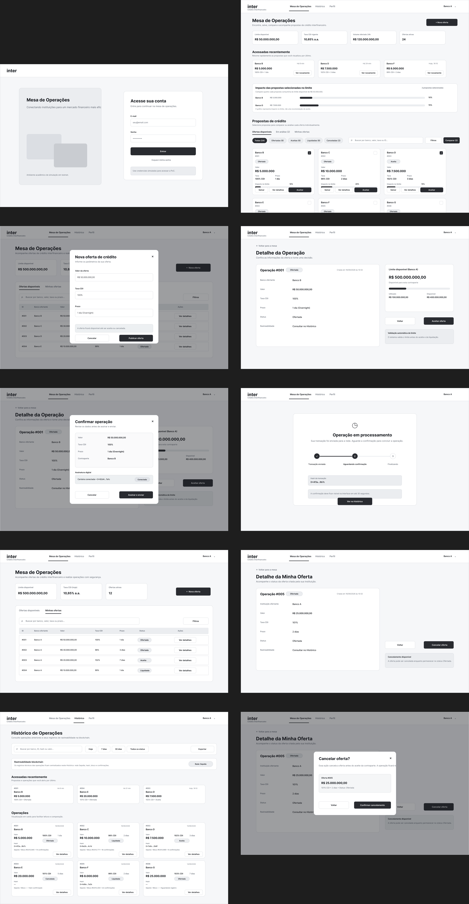

# Documentação do Frontend

> **Instrução de uso:** substitua todos os campos entre colchetes e remova as
> orientações em itálico antes da entrega.

## Controle do documento

| Campo | Preenchimento |
| --- | --- |
| Projeto | Protocolo de concessão de crédito interfinanceiro |
| Parceiro | Banco Inter |
| Equipe | Frontend |
| Responsáveis | Ana Célia Amaral, Gabriel Rodrigues, José Maia  |
| Versão | [Número da versão] |
| Última atualização | [21/09/2026] |

| Aplicação publicada | [Link do preview ou produção] |


## Sumário

1. [Visão geral](#1-visão-geral)
2. [Semana 1 — Descoberta e estruturação](#2-semana-1--descoberta-e-estruturação)
   - [Fluxo de telas](#22-fluxo-de-telas)
3. [Semana 2 — Prototipação e design system](#3-semana-2--prototipação-e-design-system)
4. [Semana 3 — Implementação das interfaces](#4-semana-3--implementação-das-interfaces)
5. [Semana 4 — Integrações](#5-semana-4--integrações)
6. [Semana 5 — Finalização e demonstração](#6-semana-5--finalização-e-demonstração)
7. [Qualidade e testes](#7-qualidade-e-testes)
8. [Rastreabilidade dos entregáveis](#8-rastreabilidade-dos-entregáveis)
9. [Conclusão](#9-conclusão)
10. [Referências](#10-referências)
11. [Anexos](#11-anexos)

---

## 1. Visão geral

### 1.1 Contexto

O Banco Inter atua como banco digital e plataforma de serviços integrados. Sua
área de *Digital Assets & Emerging Technologies* explora infraestruturas
financeiras programáveis, tokenização de ativos e novas tecnologias para
liquidez interbancária.

O projeto tem caráter acadêmico e experimental e propõe uma Prova de Conceito
(PoC) híbrida Web2/Web3 para o mercado de crédito interfinanceiro de curtíssimo
prazo (*overnight*).

### 1.2 Problema

A concessão de crédito entre instituições ainda depende de processos de
conciliação e checagem de limites que podem atrasar a negociação e a liquidação.
Isso aumenta a complexidade operacional do fechamento diário de caixa e mantém
o risco de contraparte entre o aceite e a conclusão da transação.

O frontend deve oferecer ao operador uma visão centralizada das ofertas,
limites de crédito, taxas de mercado e estados das transações, além de tornar
claras as etapas de oferta, aceite, liquidação e consulta do histórico.

### 1.3 Objetivo

Disponibilizar uma interface para simular o ciclo de vida do crédito
interfinanceiro: registrar ofertas, consultar e aceitar oportunidades, validar
limites, acompanhar a liquidação atômica por *smart contract* e consultar o
histórico rastreável das operações.

### 1.4 Escopo do frontend

**Incluído:**

- Simulador de mesa de operações para crédito interfinanceiro *overnight*.
- Registro de ofertas com taxa CDI, valor e prazo.
- Consulta de limites de crédito, taxas de mercado e status das transações.
- Aceite de ofertas após validação automática do limite da contraparte.
- Liquidação atômica simulada por *smart contract*.
- Cancelamento de uma oferta antes do aceite.
- Consulta ao histórico das operações.
- Exibição do hash da transação *on-chain* e dos estados da operação.
- Integração entre a camada Web2 e a blockchain em ambiente de testes.

**Não incluído:**

- Integração com sistemas legados ou de produção do Banco Inter.
- Movimentação de dinheiro ou ativos reais.
- Operações fora da testnet Sepolia.
- Liquidação financeira externa à blockchain.
- Manutenção, suporte ou correções após o encerramento do projeto acadêmico.

### 1.5 Público-alvo

O público principal é formado por operadores de tesouraria de instituições financeiras cadastradas, responsáveis por ofertar, aceitar e acompanhar operações interbancárias. As contrapartes cadastradas também consultam limites, condições e o histórico das transações em que participaram.

### 1.6 Tecnologias

| Categoria | Tecnologia | Versão | Situação/justificativa |
| --- | --- | --- | --- |
| Frontend | React | [Definir] | Previsto no cronograma do frontend para componentização das telas. |
| Estilização | [Definir] | [Definir] | Decisão pendente da equipe. |
| Smart contracts | Solidity e Foundry | [Definir] | Stack definida pelo TAP para implementação e testes dos contratos. |
| Blockchain | Testnet Sepolia | [Definir] | Ambiente obrigatório; não utiliza ativos reais. |
| Backend | Node.js, TypeScript e Express | [Definir] | Stack recomendada no TAP; confirmar adoção pela equipe. |
| Banco de dados | PostgreSQL | [Definir] | Tecnologia recomendada no TAP; confirmar adoção pela equipe. |
| Testes do frontend | [Definir] | [Definir] | Ferramentas e cobertura ainda não informadas. |
| Publicação | [Definir] | [Definir] | Plataforma de preview ainda não informada. |

### 1.7 Requisitos funcionais

| ID | Requisito | Impacto esperado no frontend |
| --- | --- | --- |
| RF01 | Permitir o registro de oferta de crédito *overnight* com taxa CDI, valor e prazo. | Formulário de nova oferta, validação dos campos e confirmação do registro. |
| RF02 | Validar automaticamente o limite de crédito da contraparte antes do aceite. | Exibir limite disponível e impedir ou orientar o aceite quando ele for insuficiente. |
| RF03 | Executar a transferência do token de crédito e a liquidação do ativo simultaneamente. | Solicitar confirmação, acompanhar o processamento e apresentar o resultado da liquidação. |
| RF04 | Exibir em tempo real limites de crédito, taxas de mercado e status das transações. | Manter a mesa de operações atualizada e diferenciar visualmente os estados. |
| RF05 | Registrar e permitir a consulta ao histórico completo das operações do ciclo. | Disponibilizar tela de histórico e acesso ao detalhe de cada registro. |
| RF06 | Permitir o cancelamento de uma oferta antes do aceite da contraparte. | Exibir a ação somente quando permitida e solicitar confirmação do operador. |

### 1.8 Requisitos não funcionais

| ID | Requisito | Critério para o frontend |
| --- | --- | --- |
| RNF01 | Executar todas as operações exclusivamente na testnet Sepolia. | Identificar claramente a rede e impedir ambiguidade com um ambiente de produção. |
| RNF02 | Tornar visível a confirmação da liquidação simulada em até 30 segundos após o aceite. | Apresentar estado de processamento e atualizar a interface quando houver confirmação. |
| RNF03 | Registrar timestamp, partes, taxa CDI e hash *on-chain* em toda operação. | Exibir esses dados no detalhe e no histórico quando disponibilizados pela API. |
| RNF04 | Entregar o código em repositório público, sob licença MIT e sem dependências proprietárias. | Usar apenas dependências compatíveis e documentar a licença e a execução do projeto. |

### 1.9 Regras e premissas conhecidas

- Apenas instituições cadastradas participam da simulação.
- Uma oferta só pode ser aceita após a validação do limite de crédito.
- O cancelamento é permitido somente antes do aceite pela contraparte.
- A transferência do token e a liquidação devem ocorrer de forma atômica.
- Os estados mínimos informados pelo TAP são: ofertada, aceita e liquidada.
- Todas as operações são experimentais e utilizam apenas a testnet Sepolia.

---

## 2. Semana 1 — Descoberta e estruturação

**Período:** 16/09 a 20/09


### 2.1 Fluxo de telas

<div align="center">
  <p><strong>Figura 1 — Wireframes do fluxo de telas do frontend</strong></p>
</div>



<div align="center">
  <p><em>Fonte: Elaborado pela equipe do projeto (2026).</em></p>
</div>

#### Resumo do fluxo

```text
Login
  ↓
Mesa de Operações
  │
  ├── Nova oferta
  │     ↓
  │   Modal de criação
  │     ↓
  │   Publicar
  │     ↓
  │   Minhas ofertas
  │
  ├── Oferta disponível
  │     ↓
  │   Ver detalhes
  │     ↓
  │   Aceitar oferta
  │     ↓
  │   Confirmar / Assinar
  │     ↓
  │   Aguardando confirmação
  │     ↓
  │   Histórico
  │
  └── Minhas ofertas
        ↓
      Ver detalhes
        ↓
      Cancelar oferta
        ↓
      Confirmar cancelamento
        ↓
      Histórico
```

O fluxo começa no login e direciona o usuário para a Mesa de Operações, ponto
central da aplicação. Nela, a instituição visualiza limites de crédito,
indicadores, propostas recentes e ofertas disponíveis. O usuário pode abrir os
detalhes de uma proposta, salvá-la para análise, comparar condições ou iniciar
o aceite.

No aceite, os dados da operação são revisados antes da assinatura digital. Em
seguida, a interface acompanha o envio da transação, a confirmação na rede
Sepolia e a atualização do histórico. A Mesa também permite criar uma nova
oferta informando valor, taxa CDI e prazo, além de acompanhar ou cancelar
propostas próprias quando o status permitir.

O Histórico reúne as transações e seus dados financeiros e de rastreabilidade,
como contraparte, status, hash, bloco e confirmações. A navegação principal
conecta a Mesa, o Histórico e o Perfil, enquanto as notificações informam
mudanças relevantes nas propostas.

### 2.3 Personas

Três proto-personas derivadas do TAP, dos entregáveis do ciclo e dos wireframes
(sem entrevistas; nomes, cargos e bancos fictícios). Versão completa em
[docs/ux/personas.md](ux/personas.md); pranchas visuais na página
"jornada do usuário" do Figma.

| Persona | Papel | Prioridade | O que precisa ver | Telas | Requisitos |
| --- | --- | --- | --- | --- | --- |
| Marina Duarte | Operadora da mesa de tesouraria (DI/overnight). Publica ofertas quando sobra caixa e aceita ofertas de terceiros quando falta. | Primária | Valor, taxa CDI, prazo, limite disponível e impacto no limite, contraparte, status, hash e confirmação | WEB 01–08, 10 | RF01, RF02, RF03, RF04, RF06, RNF02 |
| Ricardo Sá | Gestor de tesouraria / risco de liquidez. Define limites por contraparte e supervisiona a exposição; raramente executa. | Secundária | Limite consumido vs. disponível, impacto agregado das propostas, volume 24 h, ofertas ativas, histórico filtrável | WEB 02, 09 | RF02, RF04, RF05 |
| Camila Reis | Analista de back-office / conformidade. Concilia e audita operações; produz evidência para auditoria. | Secundária | Timestamp, partes, taxa, hash com link para o explorer da Sepolia, bloco, confirmações; busca e exportação | WEB 09, 04, 08 | RF05, RNF03 |

Dores comuns às três, herdadas do TAP: checagem manual de limites, intervalo
entre negociação e liquidação (risco de contraparte) e conciliação lenta no
fechamento diário. O avaliador do Inter no demo day é audiência, não persona:
a interface precisa ser legível em telão, mas é desenhada para as três acima.

### 2.4 Jornada do operador

Jornada única da persona primária (Marina) com dois ramos conforme a posição
de caixa do dia: **tomar crédito** (aceitar oferta de terceiro) ou **conceder
crédito** (publicar e acompanhar a própria oferta). Versão completa, com o que
precisa ver em cada etapa, estados da UI, dores do processo atual e emoção, em
[docs/ux/jornada-operador.md](ux/jornada-operador.md).

| Etapa | Tela | Objetivo | Requisito |
| --- | --- | --- | --- |
| 1. Entrar | WEB 01 | Login, carteira conectada e rede Sepolia confirmada | RNF01 |
| 2. Ler a mesa | WEB 02 | Limite, CDI vigente, volume 24 h, ofertas ativas; comparar ofertas | RF04 |
| 3. Analisar uma oferta | WEB 04 | Dados da oferta lado a lado com o limite da contraparte | RF02 |
| 4A. Confirmar e assinar | WEB 05 | Revisar e assinar na carteira; aceite = liquidação atômica | RF03 |
| 5A. Aguardar confirmação | WEB 06 | Hash visível, stepper, confirmação em até 30 s; nunca "Liquidada" otimista | RNF02, RNF03 |
| 4B. Publicar oferta | WEB 03 | Valor, taxa CDI e prazo | RF01 |
| 5B. Acompanhar minhas ofertas | WEB 07, 08, 10 | Status; cancelar somente enquanto Ofertada | RF06 |
| 6. Conferir no histórico | WEB 09 | Timestamp, partes, taxa, hash, bloco, confirmações; exportar | RF05, RNF03 |

Pontos baixos da curva emocional: a assinatura (irreversível) e a espera pela
confirmação. São as etapas que mais exigem feedback claro, estados de erro
explícitos e nenhum estado inconsistente.

A jornada também registra oito lacunas dos wireframes atuais (tela de
erro/rejeição, estado "rede errada", "Perfil" sem tela, aba "Em análise" sem
definição, "Aceita" persistida vs. transitória, atualização quando outro
operador aceita, limite insuficiente bloqueado, destino do botão "Salvar"),
como insumo para o protótipo da semana 2.

### 2.5 User stories — opcional

| ID | Requisito relacionado | História | Critérios de aceitação | Prioridade | Status |
| --- | --- | --- | --- | --- | --- |
| US-01 | RF01 | Como operador, quero criar uma oferta com taxa CDI, valor e prazo para disponibilizar crédito à contraparte. | Dados válidos devem permitir a confirmação e o registro da oferta. | [Definir] | Planejada |
| US-02 | RF02 | Como operador, quero que o limite da contraparte seja validado automaticamente para evitar um aceite sem cobertura. | O aceite só deve avançar quando houver limite disponível suficiente. | [Definir] | Planejada |
| US-03 | RF03 | Como operador, quero que a troca do token e a liquidação sejam atômicas para reduzir o risco de contraparte. | O aceite deve iniciar uma única transação e informar sucesso ou falha. | [Definir] | Planejada |
| US-04 | RF04 | Como operador, quero visualizar limites, taxas e status em tempo real para decidir e acompanhar as operações. | A mesa deve apresentar os dados atualizados e estados distinguíveis. | [Definir] | Planejada |
| US-05 | RF05 | Como operador, quero consultar o histórico para rastrear as operações realizadas. | Cada registro deve permitir consultar timestamp, partes, taxa CDI e hash. | [Definir] | Planejada |
| US-06 | RF06 | Como operador ofertante, quero cancelar uma oferta ainda não aceita para retirá-la do mercado. | A ação deve estar disponível antes do aceite e indisponível depois dele. | [Definir] | Planejada |

### 2.6 Evidências e links da semana

| Entregável | Link ou caminho | Responsável | Status |
| --- | --- | --- | --- |
| Wireframes | [Preencher] | [Preencher] | [Preencher] |
| Fluxo de navegação | [Preencher] | [Preencher] | [Preencher] |
| Personas e jornada | [docs/ux/](ux/README.md) · página "jornada do usuário" do Figma | José Maia | Proposta v0.1, a validar na sprint review |
| User stories | [Preencher] | [Preencher] | [Preencher] |

---

## 3. Semana 2 — Prototipação e design system

**Período:** 21/09 a 27/09

### 3.1 Protótipo navegável

**Link:** [Insira o link do protótipo]

**Fluxos disponíveis:**

- Criar uma oferta.
- Consultar e aceitar uma oferta disponível.
- Cancelar uma oferta ainda não aceita.
- Acompanhar a liquidação e consultar o hash.
- Consultar o histórico e abrir o detalhe de uma operação.

**Instruções de navegação:** [Preencher]

### 3.2 Visual final da aplicação

[Insira imagens das telas finais ou seus respectivos links.]

| Tela | Objetivo | Estados representados | Link ou caminho |
| --- | --- | --- | --- |
| Mesa de operações | Exibir limites, taxas, ofertas e estados das operações. | Carregamento, vazio, ofertada, aceita, liquidada e erro. | [Preencher] |
| Detalhe da operação | Reunir dados de rastreabilidade e ações disponíveis. | Ofertada, validação de limite, assinatura, processamento, liquidada, cancelada e erro. | [Preencher] |
| Histórico | Permitir consulta e acesso aos detalhes de operações anteriores. | Carregamento, vazio, resultados, nenhum resultado e erro. | [Preencher] |

### 3.3 Design system

#### Cores

| Token | Valor | Aplicação | Contraste validado |
| --- | --- | --- | --- |
| [Nome do token] | [HEX/RGB] | [Uso] | [Sim/Não] |

#### Tipografia

| Token | Família | Peso | Tamanho/altura de linha | Aplicação |
| --- | --- | --- | --- | --- |
| [Nome do token] | [Preencher] | [Preencher] | [Preencher] | [Preencher] |

#### Espaçamentos e dimensões

| Token | Valor | Aplicação |
| --- | --- | --- |
| [Nome do token] | [Preencher] | [Preencher] |

#### Componentes

##### Card de oferta

[Insira imagem, link ou especificação do componente.]

| Propriedade/variante | Descrição |
| --- | --- |
| [Preencher] | [Preencher] |

##### Badge de status

[Insira imagem, link ou especificação do componente.]

| Status | Aparência | Uso |
| --- | --- | --- |
| Ofertada | [Definir cor, ícone e rótulo] | Oferta disponível e ainda não aceita. |
| Aceita | [Definir cor, ícone e rótulo] | Oferta aceita antes da confirmação da liquidação. |
| Em processamento | [Definir cor, ícone e rótulo] | Transação enviada e aguardando confirmação na Sepolia. |
| Liquidada | [Definir cor, ícone e rótulo] | Operação concluída com hash disponível. |
| Cancelada | [Definir cor, ícone e rótulo] | Oferta retirada antes do aceite. |
| Falha | [Definir cor, ícone e rótulo] | Operação não concluída ou rejeitada. |

##### Tabela

[Insira imagem, link ou especificação do componente.]

| Propriedade/estado | Descrição |
| --- | --- |
| Colunas mínimas | Instituições, valor, taxa CDI, prazo, status e data/hora. |
| Ação de linha | Abrir o detalhe da operação. |
| Carregamento | Exibir linhas esqueleto ou indicador equivalente. |
| Vazio | Informar que ainda não há operações. |
| Erro | Explicar a falha e oferecer nova tentativa quando aplicável. |

### 3.4 Evidências e links da semana

| Entregável | Link ou caminho | Responsável | Status |
| --- | --- | --- | --- |
| Protótipo navegável | [Preencher] | [Preencher] | [Preencher] |
| Telas com visual final | [Preencher] | [Preencher] | [Preencher] |
| Design system | [Preencher] | [Preencher] | [Preencher] |

---

## 4. Semana 3 — Implementação das interfaces

**Período:** 28/09 a 04/10

### 4.1 Arquitetura do frontend

O repositório possui uma estrutura inicial independente de detalhes de
implementação. A adoção de React está prevista, mas as bibliotecas de rotas,
estado, estilização, testes e integração Web3 ainda precisam ser definidas.

```text
src/
├── assets/        # Recursos importados pela aplicação
├── components/    # Componentes reutilizáveis
├── pages/         # Mesa, detalhe e histórico
├── services/      # API, carteira e blockchain
├── styles/        # Estilos globais e tokens
└── utils/         # Funções auxiliares
```

### 4.2 Componentes implementados

| Componente | Responsabilidade | Propriedades principais | Estados | Caminho no código |
| --- | --- | --- | --- | --- |
| [Nome] | [Preencher] | [Preencher] | [Preencher] | [Preencher] |

### 4.3 Telas navegáveis com dados simulados

#### Mesa de operações

**Descrição:** [Preencher]

**Dados simulados utilizados:** [Preencher]

**Evidência:** [Insira imagem, vídeo ou link]

#### Detalhe da operação

**Descrição:** [Preencher]

**Dados simulados utilizados:** [Preencher]

**Evidência:** [Insira imagem, vídeo ou link]

#### Histórico

**Descrição:** [Preencher]

**Dados simulados utilizados:** [Preencher]

**Evidência:** [Insira imagem, vídeo ou link]

### 4.4 Rotas da aplicação

> Rotas propostas com base nas telas previstas; confirmar durante a
> implementação.

| Rota | Tela | Finalidade | Parâmetros | Proteção de acesso |
| --- | --- | --- | --- | --- |
| `/` | Mesa de operações | Consultar ofertas, limites, taxas e status. | Nenhum | [Definir] |
| `/ofertas/nova` | Nova oferta | Registrar taxa CDI, valor e prazo. | Nenhum | Carteira conectada [confirmar] |
| `/operacoes/:id` | Detalhe da operação | Consultar dados e executar ações permitidas. | Identificador da operação | Carteira conectada [confirmar] |
| `/historico` | Histórico | Consultar operações registradas. | Filtros [definir] | [Definir] |

### 4.5 Preview publicado

| Campo | Preenchimento |
| --- | --- |
| URL | [Preencher] |
| Ambiente | [Preencher] |
| Versão/commit | [Preencher] |
| Data da publicação | [Preencher] |
| Instruções de acesso | [Preencher] |

### 4.6 Evidências e links da semana

| Entregável | Link ou caminho | Responsável | Status |
| --- | --- | --- | --- |
| Componentes em React | [Preencher] | [Preencher] | [Preencher] |
| Telas navegáveis | [Preencher] | [Preencher] | [Preencher] |
| Preview da aplicação | [Preencher] | [Preencher] | [Preencher] |

---

## 5. Semana 4 — Integrações

**Período:** 05/10 a 11/10

### 5.1 Integração com a API

| Tela/ação | Método | Endpoint | Dados enviados | Dados recebidos | Tratamento de erro |
| --- | --- | --- | --- | --- | --- |
| [Preencher] | [GET/POST/etc.] | [Preencher] | [Preencher] | [Preencher] | [Preencher] |

### 5.2 Dados reais nas telas

| Tela | Fonte dos dados | Transformações | Atualização | Evidência |
| --- | --- | --- | --- | --- |
| Mesa de operações | [Preencher] | [Preencher] | [Preencher] | [Preencher] |
| Detalhe da operação | [Preencher] | [Preencher] | [Preencher] | [Preencher] |
| Histórico | [Preencher] | [Preencher] | [Preencher] | [Preencher] |

### 5.3 Conexão da carteira

| Campo | Preenchimento |
| --- | --- |
| Carteira/provedor | [Preencher] |
| Rede | Sepolia (testnet) |
| Fluxo de conexão | Solicitar conexão → validar conta e rede → autorizar ações ou orientar troca para Sepolia. |
| Permissões solicitadas | [Preencher] |
| Dados exibidos | Endereço resumido da conta e identificação clara da rede [confirmar]. |
| Tratamento de desconexão | Bloquear ações de assinatura e oferecer reconexão [confirmar]. |

**Evidência:** [Insira imagem, vídeo ou link]

### 5.4 Assinatura da operação e hash

**Fluxo de assinatura:**

1. O operador revisa os dados da oferta ou do aceite.
2. A aplicação solicita a assinatura na carteira conectada à Sepolia.
3. A interface informa o processamento e aguarda a confirmação.
4. Em caso de sucesso, a operação exibe o status atualizado e o hash.
5. Em caso de rejeição ou falha, a interface explica o resultado e a possível recuperação.

| Campo | Preenchimento |
| --- | --- |
| Ação que inicia a assinatura | Confirmação de uma ação *on-chain*, como oferta, aceite ou cancelamento [validar com o contrato]. |
| Confirmação solicitada | Resumo da instituição, valor, taxa CDI, prazo e ação. |
| Local de exibição do hash | Detalhe da operação e histórico. |
| Link para o explorador | Explorador da Sepolia [URL a definir]. |
| Evidência | [Preencher] |

### 5.5 Estados de interface

| Contexto | Carregamento | Sucesso | Vazio | Erro | Recuperação |
| --- | --- | --- | --- | --- | --- |
| Consulta de operações | Indicador durante a busca. | Dados e horários atualizados. | Mensagem sem operações. | Mensagem de indisponibilidade. | Nova tentativa. |
| Conexão da carteira | Solicitação em andamento. | Conta e rede exibidas. | Não se aplica. | Carteira ausente, acesso recusado ou rede incorreta. | Reconectar ou trocar para Sepolia. |
| Assinatura da operação | Aguardando ação na carteira. | Assinatura enviada. | Não se aplica. | Assinatura rejeitada ou falha no envio. | Tentar novamente sem duplicar a operação. |
| Confirmação da operação | Transação pendente, com tempo decorrido. | Status liquidada e hash visível. | Não se aplica. | Falha ou ausência de confirmação. | Atualizar status ou repetir consulta; regra a definir. |

### 5.6 Evidências e links da semana

| Entregável | Link ou caminho | Responsável | Status |
| --- | --- | --- | --- |
| Integração com a API | [Preencher] | [Preencher] | [Preencher] |
| Conexão da carteira | [Preencher] | [Preencher] | [Preencher] |
| Assinatura e exibição do hash | [Preencher] | [Preencher] | [Preencher] |
| Estados de carregamento e erro | [Preencher] | [Preencher] | [Preencher] |

---

## 6. Semana 5 — Finalização e demonstração

**Período:** 12/10 a 17/10

### 6.1 Ajustes finais da interface

| Ajuste | Motivação | Tela/componente | Evidência antes/depois | Status |
| --- | --- | --- | --- | --- |
| [Preencher] | [Preencher] | [Preencher] | [Preencher] | [Preencher] |

### 6.2 Acessibilidade e apresentação em telão

| Verificação | Critério utilizado | Resultado | Ajuste realizado | Evidência |
| --- | --- | --- | --- | --- |
| Contraste | [Preencher] | [Preencher] | [Preencher] | [Preencher] |
| Tamanho dos textos | [Preencher] | [Preencher] | [Preencher] | [Preencher] |
| Tamanho dos controles | [Preencher] | [Preencher] | [Preencher] | [Preencher] |
| Navegação por teclado | [Preencher] | [Preencher] | [Preencher] | [Preencher] |
| Responsividade | [Preencher] | [Preencher] | [Preencher] | [Preencher] |
| Visualização em telão | [Preencher] | [Preencher] | [Preencher] | [Preencher] |

### 6.3 Vídeo de demonstração

| Campo | Preenchimento |
| --- | --- |
| Link do vídeo | [Preencher] |
| Duração | [Preencher] |
| Responsáveis | [Preencher] |
| Link do roteiro | [Preencher] |
| Legendas revisadas | [Sim/Não] |
| Data de publicação | [Preencher] |

#### Roteiro

| Tempo estimado | Cena | Narração | Recurso visual | Responsável |
| --- | --- | --- | --- | --- |
| [00:00–00:00] | [Preencher] | [Preencher] | [Preencher] | [Preencher] |

### 6.4 Evidências e links da semana

| Entregável | Link ou caminho | Responsável | Status |
| --- | --- | --- | --- |
| Interface final revisada | [Preencher] | [Preencher] | [Preencher] |
| Revisão para apresentação | [Preencher] | [Preencher] | [Preencher] |
| Vídeo demo com legenda | [Preencher] | [Preencher] | [Preencher] |

---

## 7. Qualidade e testes

### 7.1 Estratégia de testes

A estratégia deve combinar testes de componentes, integração com a API e
testes dos fluxos críticos ponta a ponta. As operações blockchain devem ser
executadas exclusivamente na testnet Sepolia. As ferramentas, a meta de
cobertura e os ambientes de execução ainda serão definidos pela equipe.

Critérios mínimos derivados do TAP:

- impedir o aceite quando o limite de crédito for insuficiente;
- executar a liquidação de forma atômica;
- refletir a confirmação simulada na interface em até 30 segundos;
- registrar e exibir timestamp, partes, taxa CDI e hash da transação;
- permitir o cancelamento somente antes do aceite;
- não acessar sistemas de produção nem movimentar ativos reais.

### 7.2 Casos de teste

| ID | Funcionalidade | Cenário | Resultado esperado | Resultado obtido | Evidência | Status |
| --- | --- | --- | --- | --- | --- | --- |
| CT-01 | Nova oferta | Informar taxa CDI, valor e prazo válidos e confirmar. | A oferta é registrada com status ofertada. | [Preencher após execução] | [Preencher] | Planejado |
| CT-02 | Validação de limite | Tentar aceitar uma oferta sem limite suficiente. | O aceite é impedido e a interface explica o motivo. | [Preencher após execução] | [Preencher] | Planejado |
| CT-03 | Liquidação atômica | Aceitar uma oferta com limite suficiente. | Token e ativo são liquidados na mesma transação simulada. | [Preencher após execução] | [Preencher] | Planejado |
| CT-04 | Confirmação | Acompanhar uma liquidação após o aceite. | A confirmação fica visível em até 30 segundos. | [Preencher após execução] | [Preencher] | Planejado |
| CT-05 | Rastreabilidade | Abrir uma operação concluída no histórico. | Timestamp, partes, taxa CDI e hash são exibidos. | [Preencher após execução] | [Preencher] | Planejado |
| CT-06 | Cancelamento | Cancelar uma oferta antes do aceite. | A oferta é cancelada e deixa de aceitar contraparte. | [Preencher após execução] | [Preencher] | Planejado |
| CT-07 | Cancelamento bloqueado | Tentar cancelar uma oferta já aceita. | A ação não é permitida. | [Preencher após execução] | [Preencher] | Planejado |
| CT-08 | Rede incorreta | Tentar realizar uma ação fora da Sepolia. | A aplicação bloqueia a ação e orienta a troca de rede. | [Preencher após execução] | [Preencher] | Planejado |

### 7.3 Compatibilidade

| Navegador/dispositivo | Versão/resolução | Resultado | Observações |
| --- | --- | --- | --- |
| [Preencher] | [Preencher] | [Preencher] | [Preencher] |

### 7.4 Problemas conhecidos

| ID | Problema | Impacto | Solução temporária | Próximo passo |
| --- | --- | --- | --- | --- |
| [Preencher] | [Preencher] | [Preencher] | [Preencher] | [Preencher] |

---

## 8. Rastreabilidade dos entregáveis

| Semana | Entregável | Requisito relacionado | Evidência | Responsável | Status |
| --- | --- | --- | --- | --- | --- |
| 1 | Wireframes, fluxo de telas, persona e jornada | RF01–RF06 | [Preencher] | [Preencher] | Planejado |
| 2 | Protótipo navegável e design system | RF01–RF06, RNF02 e RNF03 | [Preencher] | [Preencher] | Planejado |
| 3 | Componentes React, telas navegáveis e preview | RF01, RF04–RF06 | [Preencher] | [Preencher] | Planejado |
| 4 | API, carteira, assinatura, hash e estados da interface | RF01–RF06, RNF01–RNF03 | [Preencher] | [Preencher] | Planejado |
| 5 | Ajustes finais, acessibilidade e vídeo demo | RNF02 e RNF04 | [Preencher] | [Preencher] | Planejado |

---

## 9. Conclusão

### 9.1 Resultados alcançados

[Preencher ao final do projeto com resultados verificáveis, links e relação
entre as entregas e os requisitos RF01–RF06 e RNF01–RNF04.]

### 9.2 Limitações

- A PoC não se conecta aos sistemas legados ou de produção do Banco Inter.
- A solução não movimenta dinheiro nem ativos reais.
- As operações ocorrem exclusivamente na testnet Sepolia.
- A liquidação é simulada dentro da blockchain, sem liquidação financeira externa.
- O projeto acadêmico não prevê manutenção, suporte ou correções após o encerramento.

### 9.3 Próximos passos

- Validar wireframes, persona, jornada e fluxo de telas com o parceiro.
- Definir as bibliotecas do frontend e a integração com a carteira.
- Implementar e testar os fluxos de oferta, aceite, cancelamento e liquidação.
- Registrar evidências e resultados reais ao final de cada semana.

---

## 10. Referências

- INTELI BLOCKCHAIN; BANCO INTER. **TAP — Protocolo de concessão de crédito
  interfinanceiro**. Termo de Abertura do Projeto fornecido à equipe.
- [AUTOR/ORGANIZAÇÃO. Título. Ano. Link. Data de acesso.]

---

## 11. Anexos

| Anexo | Descrição | Link ou caminho |
| --- | --- | --- |
| TAP do projeto | Termo de Abertura do Projeto utilizado como fonte da visão geral, requisitos e restrições. | [Adicionar cópia ou link autorizado] |
| [Nome] | [Preencher] | [Preencher] |
