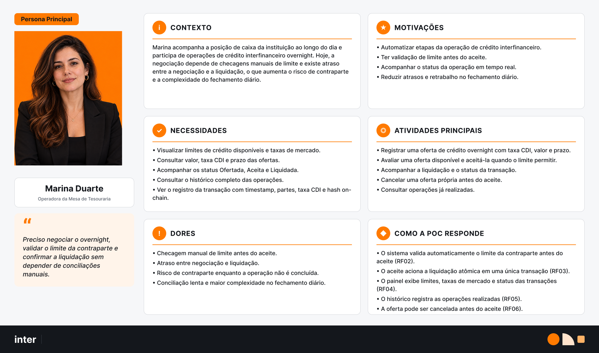
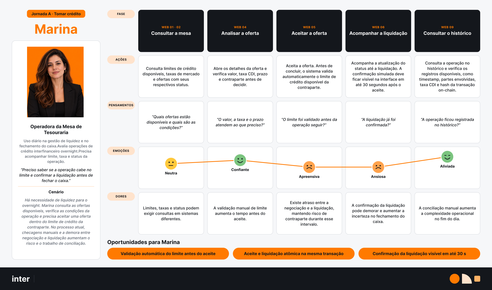
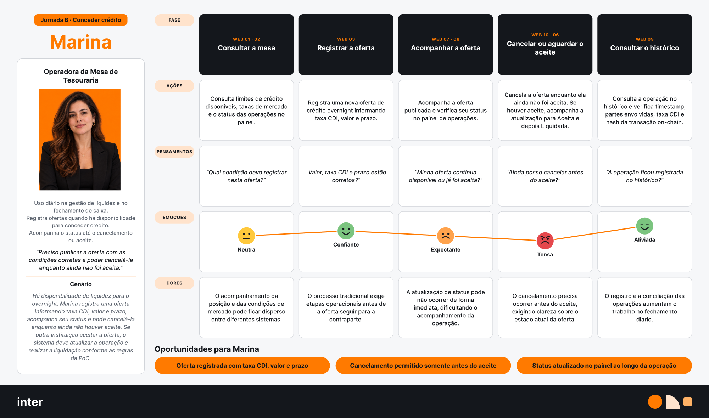

#  Protocolo de concessão de crédito interfinanceiro - Projeto Banco Inter- Inteli Blockchain

#### Integrantes

- <a href="https://www.linkedin.com/in/ana-c%C3%A9lia-amaral/">Ana Célia Augusta Santos do Amaral</a>
- <a href="https://www.linkedin.com/in/rodriguesgabrieleng">Gabriel Rodrigues</a>
- <a href="https://www.linkedin.com/in/jos%C3%A9-guilherme-gon%C3%A7alves-maia/">José Guilherme Gonçalves Maia</a>


## Controle do documento

| Aplicação publicada | Não há URL de publicação registrada neste repositório. Execute localmente conforme o [README](../README.md). |

## Sumário

1. [Visão geral](#1-visão-geral)
2. [Semana 1 — Descoberta e estruturação](#2-semana-1--descoberta-e-estruturação)
   - [Fluxo de telas](#21-fluxo-de-telas)
   - [Persona principal](#22-persona-principal)
   - [Jornadas da persona](#23-jornadas-da-persona)
   - [User stories](#24-user-stories)
3. [Semana 2 — Prototipação e design system](#3-semana-2--prototipação-e-design-system)
4. [Implementação atual](#4-implementação-atual)
5. [Integração com API e carteira](#5-integração-com-api-e-carteira)
6. [Demonstração e limites](#6-demonstração-e-limites)
7. [Qualidade e testes](#7-qualidade-e-testes)
8. [Rastreabilidade](#8-rastreabilidade)
9. [Conclusão](#9-conclusão)
10. [Referências](#10-referências)
11. [Anexos](#11-anexos)

---

## 1. Visão geral

### 1.1 Contexto

O Banco Inter atua como banco digital e plataforma de serviços integrados. Sua
área de *Digital Assets & Emerging Technologies* explora infraestruturas
financeiras programáveis, tokenização de ativos e novas tecnologias para
liquidez interbancária.

O projeto tem caráter acadêmico e experimental e propõe uma Prova de Conceito
(PoC) híbrida Web2/Web3 para o mercado de crédito interfinanceiro de curtíssimo
prazo (*overnight*).

### 1.2 Problema

A concessão de crédito entre instituições ainda depende de processos de
conciliação e checagem de limites que podem atrasar a negociação e a liquidação.
Isso aumenta a complexidade operacional do fechamento diário de caixa e mantém
o risco de contraparte entre o aceite e a conclusão da transação.

O frontend deve oferecer ao operador uma visão centralizada das ofertas,
limites de crédito, taxas de mercado e estados das transações, além de tornar
claras as etapas de oferta, aceite, liquidação e consulta do histórico.

### 1.3 Objetivo

Disponibilizar uma interface para simular o ciclo de vida do crédito
interfinanceiro: registrar ofertas, consultar e aceitar oportunidades, validar
limites, acompanhar a liquidação atômica por *smart contract* e consultar o
histórico rastreável das operações.

### 1.4 Escopo do frontend

**Incluído:**

- Simulador de mesa de operações para crédito interfinanceiro *overnight*.
- Registro de ofertas com taxa CDI, valor e prazo.
- Consulta de limites de crédito, taxas de mercado e status das transações.
- Aceite de ofertas após validação automática do limite da contraparte.
- Liquidação atômica simulada por *smart contract*.
- Cancelamento de uma oferta antes do aceite.
- Consulta ao histórico das operações.
- Exibição do hash da transação *on-chain* e dos estados da operação.
- Integração entre a camada Web2 e a blockchain em ambiente de testes.

**Não incluído:**

- Integração com sistemas legados ou de produção do Banco Inter.
- Movimentação de dinheiro ou ativos reais.
- Operações fora da testnet Sepolia.
- Liquidação financeira externa à blockchain.
- Manutenção, suporte ou correções após o encerramento do projeto acadêmico.

### 1.5 Público-alvo

O público principal é formado por operadores de tesouraria de instituições financeiras cadastradas, responsáveis por ofertar, aceitar e acompanhar operações interbancárias. As contrapartes cadastradas também consultam limites, condições e o histórico das transações em que participaram.

### 1.6 Tecnologias

| Categoria | Tecnologia | Versão | Situação/justificativa |
| --- | --- | --- | --- |
| Frontend | React, React Router e Vite | 19, 7 e 8 | Telas e rotas implementadas em JavaScript/JSX. |
| Estilização | Tailwind CSS | 4 | Estilos globais e tokens em `src/styles/`. |
| Smart contracts | Solidity e Foundry | Repositório do contrato | O frontend usa o deployment informado pela API; os contratos não estão neste repositório. |
| Blockchain | Ethereum Sepolia | chain ID 11155111 | Rede usada para operações assinadas pela MetaMask. |
| Backend | API `backend-banco-inter` | Repositório separado | Fornece ofertas, limites, deployment e intenções de transação. |
| Banco de dados | PostgreSQL ou memória | Configuração do backend | O frontend não acessa o banco diretamente. |
| Testes do frontend | `node:test` | Integrado ao Node.js | `npm test` executa os testes em `tests/`. |
| Publicação | Vite build | Sem hospedagem registrada | `npm run build` gera `dist/`. |

### 1.7 Requisitos funcionais

| ID | Requisito | Impacto esperado no frontend |
| --- | --- | --- |
| RF01 | Permitir o registro de oferta de crédito *overnight* com taxa CDI, valor e prazo. | Formulário de nova oferta, validação dos campos e confirmação do registro. |
| RF02 | Validar automaticamente o limite de crédito da contraparte antes do aceite. | Exibir limite disponível e impedir ou orientar o aceite quando ele for insuficiente. |
| RF03 | Executar a transferência do token de crédito e a liquidação do ativo simultaneamente. | Solicitar confirmação, acompanhar o processamento e apresentar o resultado da liquidação. |
| RF04 | Exibir em tempo real limites de crédito, taxas de mercado e status das transações. | Manter a mesa de operações atualizada e diferenciar visualmente os estados. |
| RF05 | Registrar e permitir a consulta ao histórico completo das operações do ciclo. | Disponibilizar tela de histórico e acesso ao detalhe de cada registro. |
| RF06 | Permitir o cancelamento de uma oferta antes do aceite da contraparte. | Exibir a ação somente quando permitida e solicitar confirmação do operador. |

### 1.8 Requisitos não funcionais

| ID | Requisito | Critério para o frontend |
| --- | --- | --- |
| RNF01 | Executar todas as operações exclusivamente na testnet Sepolia. | Identificar claramente a rede e impedir ambiguidade com um ambiente de produção. |
| RNF02 | Tornar visível a confirmação da liquidação simulada em até 30 segundos após o aceite. | Apresentar estado de processamento e atualizar a interface quando houver confirmação. |
| RNF03 | Registrar timestamp, partes, taxa CDI e hash *on-chain* em toda operação. | Exibir esses dados no detalhe e no histórico quando disponibilizados pela API. |
| RNF04 | Entregar o código em repositório público, sob licença MIT e sem dependências proprietárias. | Usar apenas dependências compatíveis e documentar a licença e a execução do projeto. |

### 1.9 Regras e premissas conhecidas

- Apenas instituições cadastradas participam da simulação.
- Uma oferta só pode ser aceita após a validação do limite de crédito.
- O cancelamento é permitido somente antes do aceite pela contraparte.
- A transferência do token e a liquidação devem ocorrer de forma atômica.
- Os estados mínimos informados pelo TAP são: ofertada, aceita e liquidada.
- Operações assinadas usam apenas a testnet Sepolia; a demonstração local usa dados sintéticos sem transação na rede.

---

## 2. Semana 1 — Descoberta e estruturação

**Período:** 16/09 a 20/09


### 2.1 Fluxo de telas

<div align="center">
  <p><strong>Figura 1 — Wireframes do fluxo de telas do frontend</strong></p>
</div>


<div align="center">
  <p><em>Fonte: Elaborado pela equipe do projeto (2026).</em></p>
</div>

#### Resumo do fluxo

```text
Login
  ↓
Mesa de Operações
  │
  ├── Nova oferta
  │     ↓
  │   Modal de criação
  │     ↓
  │   Publicar
  │     ↓
  │   Minhas ofertas
  │
  ├── Oferta disponível
  │     ↓
  │   Ver detalhes
  │     ↓
  │   Aceitar oferta
  │     ↓
  │   Confirmar / Assinar
  │     ↓
  │   Aguardando confirmação
  │     ↓
  │   Histórico
  │
  └── Minhas ofertas
        ↓
      Ver detalhes
        ↓
      Cancelar oferta
        ↓
      Confirmar cancelamento
        ↓
      Histórico
```

O fluxo começa no login e direciona o usuário para a Mesa de Operações, ponto
central da aplicação. Nela, a instituição visualiza limites de crédito,
indicadores, propostas recentes e ofertas disponíveis. O usuário pode abrir os
detalhes de uma proposta, salvá-la para análise, comparar condições ou iniciar o aceite.

No aceite, os dados da operação são revisados antes da assinatura digital. Em
seguida, a interface acompanha o envio da transação, a confirmação na rede
Sepolia e a atualização do histórico. A Mesa também permite criar uma nova
oferta informando valor, taxa CDI e prazo, além de acompanhar ou cancelar
propostas próprias quando o status permitir.

O Histórico reúne as transações e seus dados financeiros e de rastreabilidade, como contraparte, status, hash, bloco e confirmações. A navegação principal conecta a Mesa, o Histórico e o Perfil, enquanto as notificações informam mudanças relevantes nas propostas.

### 2.2 Persona principal

A persona principal da PoC é **Marina Duarte**, operadora da Mesa de Tesouraria.
Trata-se de uma proto-persona construída a partir do TAP, dos requisitos e dos
wireframes; portanto, seu nome e seu perfil são fictícios e ainda devem ser
validados com usuários ou com o parceiro.

<div align="center">
  <p><strong>Figura 2 — Persona principal: Marina Duarte</strong></p>
</div>



<div align="center">
  <p><em>Fonte: Elaborado pela equipe do projeto (2026).</em></p>
</div>

Marina acompanha diariamente a posição de caixa da instituição e participa de
operações de crédito interfinanceiro *overnight*. Quando há falta de liquidez,
ela avalia e aceita uma oferta de terceiro; quando há disponibilidade, registra
e acompanha uma oferta própria. Seu objetivo é concluir essas operações dentro
do limite da contraparte, com segurança e com evidência clara da liquidação.

| Aspecto | Síntese para o projeto |
| --- | --- |
| Motivações | Automatizar etapas, validar o limite antes do aceite, acompanhar o status em tempo real e reduzir atrasos e retrabalho. |
| Necessidades | Consultar valor, taxa CDI, prazo, contraparte, limite disponível, status e histórico; visualizar timestamp e hash *on-chain*. |
| Atividades principais | Registrar, analisar, aceitar, acompanhar e cancelar ofertas próprias antes do aceite; consultar operações já realizadas. |
| Dores | Checagem manual de limite, atraso entre negociação e liquidação, risco de contraparte e conciliação lenta no fechamento diário. |
| Resposta da PoC | Validação automática do limite, liquidação atômica no aceite, painel atualizado, histórico rastreável e cancelamento restrito ao período anterior ao aceite. |

Para a experiência, isso significa apresentar as condições da operação sem
ambiguidade, revisar ações irreversíveis antes da assinatura e manter feedback
contínuo até a confirmação da transação.

### 2.3 Jornadas da persona

A jornada de Marina possui dois caminhos determinados pela posição de caixa do
dia: **tomar crédito**, aceitando uma oferta disponível, ou **conceder crédito**,
publicando uma oferta própria. Os dois caminhos começam na consulta à Mesa de
Operações e terminam no histórico, que concentra a evidência da transação.

#### Jornada A — Tomar crédito

<div align="center">
  <p><strong>Figura 3 — Marina toma crédito ao aceitar uma oferta de terceiro</strong></p>
</div>



<div align="center">
  <p><em>Fonte: Elaborado pela equipe do projeto (2026).</em></p>
</div>

| Etapa | Ação e necessidade principal | Resposta esperada da interface |
| --- | --- | --- |
| Consultar a mesa | Compara ofertas, limites, taxas e status. | Centralizar informações e permitir leitura rápida das condições. |
| Analisar a oferta | Confere valor, taxa CDI, prazo e contraparte. | Mostrar os dados da oferta junto do limite disponível. |
| Aceitar a oferta | Confirma a operação dentro do limite. | Validar o limite automaticamente e solicitar revisão antes da assinatura. |
| Acompanhar a liquidação | Aguarda a conclusão da transação. | Exibir processamento, hash e confirmação em até 30 segundos, sem indicar liquidação antes da confirmação real. |
| Consultar o histórico | Verifica se a operação foi registrada. | Apresentar timestamp, partes, taxa CDI, status e hash *on-chain*. |

O momento de maior tensão ocorre entre o aceite e a confirmação. A interface
deve deixar claro se a transação está aguardando assinatura, processando,
liquidada ou se falhou, evitando estados inconsistentes.

#### Jornada B — Conceder crédito

<div align="center">
  <p><strong>Figura 4 — Marina concede crédito ao publicar e acompanhar uma oferta própria</strong></p>
</div>



<div align="center">
  <p><em>Fonte: Elaborado pela equipe do projeto (2026).</em></p>
</div>

| Etapa | Ação e necessidade principal | Resposta esperada da interface |
| --- | --- | --- |
| Consultar a mesa | Verifica limites, taxas e operações em andamento. | Reunir a posição atual e as condições de mercado. |
| Registrar a oferta | Informa taxa CDI, valor e prazo. | Validar os campos e confirmar a publicação da oferta. |
| Acompanhar a oferta | Observa se a oferta continua disponível ou foi aceita. | Atualizar o status no painel sem exigir conciliação manual. |
| Cancelar ou aguardar o aceite | Cancela enquanto a oferta ainda não foi aceita ou acompanha a liquidação após o aceite. | Permitir cancelamento somente no estado “Ofertada” e bloquear a ação após o aceite. |
| Consultar o histórico | Confirma o registro final da operação. | Manter os dados e a evidência *on-chain* disponíveis para consulta. |

Nesta jornada, a principal necessidade é confiar no estado atual da oferta.
Se outra instituição a aceitar enquanto a tela estiver aberta, o status e as
ações disponíveis precisam ser atualizados imediatamente.

#### Diretrizes de UX extraídas das jornadas

- Bloquear o aceite quando o limite for insuficiente e explicar o motivo.
- Identificar carteira desconectada ou rede diferente da Sepolia antes da operação.
- Exigir revisão explícita antes de assinar um aceite ou cancelamento.
- Mostrar estados de carregamento, rejeição, falha e demora na confirmação.
- Exibir o hash assim que a transação for enviada e só usar o status “Liquidada” após a confirmação.
- Atualizar ofertas aceitas ou canceladas por outra parte e remover ações que deixaram de ser válidas.

### 2.4 User stories

As histórias abaixo consideram Marina Duarte como usuária principal e cobrem os dois caminhos da jornada: tomar e conceder crédito. Os critérios descrevem o
 comportamento mínimo esperado da interface e devem ser detalhados em cenários
de teste durante o refinamento.

| ID | Requisito relacionado | História | Critérios de aceitação | Prioridade | Status |
| --- | --- | --- | --- | --- | --- |
| US-01 | RF01 | Como Marina, quero registrar uma oferta informando valor, taxa CDI e prazo para disponibilizar o caixa excedente a outras instituições. | Os três campos são obrigatórios e validados; antes da publicação, a interface apresenta um resumo; após a confirmação, a oferta aparece em “Minhas ofertas” com status **Ofertada**. | Alta | Backlog |
| US-02 | RF02 | Como Marina, quero que o limite da contraparte seja validado automaticamente antes do aceite para não concluir uma operação sem cobertura. | A interface mostra o limite disponível e o impacto da oferta; o limite é revalidado no aceite; se for insuficiente, a operação é bloqueada e a mensagem informa o motivo. | Crítica | Backlog |
| US-03 | RF03, RNF02 | Como Marina, quero aceitar uma oferta e acompanhar a liquidação em uma única transação para reduzir o risco de contraparte. | Antes da assinatura, a interface exibe o resumo da operação e a carteira conectada; após o envio, mostra processamento e hash; o status muda para **Liquidada** somente após confirmação, prevista em até 30 segundos; rejeição, falha ou demora são informadas sem criar estado inconsistente. | Crítica | Backlog |
| US-04 | RF04 | Como Marina, quero visualizar limites, taxas e status atualizados na Mesa para decidir e acompanhar as operações com rapidez. | A Mesa exibe limite disponível, CDI vigente e ofertas com valor, taxa, prazo, contraparte e status; mudanças de aceite ou cancelamento atualizam a oferta e as ações disponíveis sem exigir recarregamento manual. | Alta | Backlog |
| US-05 | RF05, RNF03 | Como Marina, quero consultar o histórico das operações para confirmar a liquidação e ter evidências para a conciliação. | O histórico permite localizar e abrir uma operação; cada registro apresenta timestamp, partes, valor, taxa CDI, prazo, status e hash *on-chain*; quando disponível, o hash direciona ao explorador da Sepolia. | Alta | Backlog |
| US-06 | RF06 | Como Marina, quero cancelar uma oferta própria ainda não aceita para retirá-la do mercado quando as condições mudarem. | A ação de cancelamento aparece somente enquanto a oferta está **Ofertada**; a interface solicita revisão e confirmação; após o aceite por outra instituição, a ação é removida ou bloqueada e o novo status é apresentado. | Alta | Backlog |
| US-07 | RNF01 | Como Marina, quero identificar a carteira e a rede conectadas antes de assinar para evitar uma operação no ambiente incorreto. | A interface informa a carteira e a rede atuais; operações são bloqueadas quando a carteira está desconectada ou fora da Sepolia; a mensagem orienta a conexão ou troca de rede. | Crítica | Backlog |


---

## 3. Semana 2 — Prototipação e design system

**Período:** 21/09 a 27/09

### 3.1 Protótipo navegável

**Link:** O link do protótipo não está registrado neste repositório; o [arquivo de design](https://www.figma.com/design/Mfw2YIbDKTmjuyLKGII7JI/Frontend-Projeto-Inter?node-id=351-106) contém o design system.

**Fluxos contemplados pela implementação:**

- Criar uma oferta.
- Consultar e aceitar uma oferta disponível.
- Cancelar uma oferta ainda não aceita.
- Acompanhar a liquidação e consultar o hash.
- Consultar o histórico e abrir o detalhe de uma operação.

**Instruções de navegação:** A implementação pode ser explorada localmente a partir de `/`, seguindo o [README](../README.md).

### 3.2 Visual final da aplicação

As telas implementadas podem ser abertas localmente. Não há capturas finais versionadas.

| Tela | Objetivo | Estados representados | Link ou caminho |
| --- | --- | --- | --- |
| Mesa de operações | Exibir limites, taxas, ofertas e estados das operações. | Carregamento, vazio, ofertada, liquidada e erro. | `src/pages/MesaOperacoes.jsx` |
| Detalhe da operação | Reunir dados de rastreabilidade e ações disponíveis. | Ofertada, validação de limite, assinatura, processamento, liquidada, cancelada e erro. | `src/pages/DetalheOperacaoApi.jsx` |
| Histórico | Permitir consulta e acesso aos detalhes de operações anteriores. | Carregamento, vazio, resultados, nenhum resultado e erro. | `src/pages/Historico.jsx` |

### 3.3 Design system

O design system fica no arquivo do Figma "Frontend-Projeto-Inter" ([Design System · Mesa de Operações](https://www.figma.com/design/Mfw2YIbDKTmjuyLKGII7JI/Frontend-Projeto-Inter?node-id=351-106)), e os tokens são espelhados com os mesmos nomes em `src/styles/tokens.css`, com temas claro e escuro. A Mesa tem identidade própria, com laranja como acento: a TAP autoriza apenas o uso do logotipo do parceiro para divulgação, por isso não reproduzimos a identidade visual do Inter. As fontes são Archivo, IBM Plex Sans e IBM Plex Mono, todas sob licença OFL, compatível com o RNF04. Ele fica na página "Design System" do arquivo.

#### Cores

Os contrastes seguem o formato claro / escuro e foram medidos pela razão WCAG 2.1 (mínimo AA: 4,5:1 para texto, 3:1 para bordas e foco).

| Token | Valor | Aplicação | Contraste validado |
| --- | --- | --- | --- |
| `fundo/canvas` (`--cor-fundo-canvas`) | Claro #F3F5F8 · Escuro #0D1117 | Fundo geral das telas. | Base dos pares de texto |
| `fundo/superficie` (`--cor-fundo-superficie`) | Claro #FFFFFF · Escuro #151B23 | Cards, painéis, tabela e modais. | Base dos pares de texto |
| `fundo/rebaixado` (`--cor-fundo-rebaixado`) | Claro #EAEEF3 · Escuro #1C232D | Cabeçalho de tabela, campos e áreas agrupadas. | Base dos pares de texto |
| `texto/principal` (`--cor-texto-principal`) | Claro #131A22 · Escuro #E6EBF1 | Valores, títulos e texto principal. | Sim — 16,0:1 / 15,8:1 sobre canvas (mín. 15,0:1 / 13,2:1) |
| `texto/secundario` (`--cor-texto-secundario`) | Claro #4E5968 · Escuro #A3AEBB | Rótulos, cabeçalhos de coluna e texto de apoio. | Sim — 6,5:1 / 8,4:1 sobre canvas (mín. 6,1:1 / 7,0:1) |
| `texto/sutil` (`--cor-texto-sutil`) | Claro #5A6573 · Escuro #8893A1 | Legendas, timestamps e placeholders. | Sim — 5,4:1 / 6,1:1 sobre canvas (mín. 5,1:1 / 5,1:1) |
| `borda/padrao` (`--cor-borda-padrao`) | Claro #D3D9E1 · Escuro #2A3440 | Divisórias e contorno de cards. | Não se aplica — divisória decorativa |
| `borda/forte` (`--cor-borda-forte`) | Claro #788391 · Escuro #6B7684 | Contorno de campos e controles. | Sim — 3,5:1 / 4,1:1 sobre canvas (mín. 3,3:1 / 3,4:1) |
| `acento/preenchimento` (`--cor-acento-preenchimento`) | Claro #FF7A00 · Escuro #FF8A1F | Fundo do botão de ação principal. | Base de `acento/sobre` |
| `acento/sobre` (`--cor-acento-sobre`) | Claro #131A22 · Escuro #131A22 | Texto e ícone sobre o laranja. | Sim — 6,7:1 / 7,4:1 sobre `acento/preenchimento` |
| `acento/texto` (`--cor-acento-texto`) | Claro #B34700 · Escuro #FF9E47 | Links e texto de destaque em laranja. | Sim — 5,0:1 / 9,2:1 sobre canvas (mín. 4,7:1 / 7,7:1) |
| `foco/anel` (`--cor-foco-anel`) | Claro #0B5FD6 · Escuro #5B9BFF | Anel de foco de teclado. | Sim — 5,3:1 / 6,8:1 sobre canvas (mín. 5,0:1 / 5,7:1) |
| `status/ofertada/texto` (`--cor-status-ofertada-texto`) | Claro #1C4FA0 · Escuro #8DB4F5 | Rótulo e trilho do status Ofertada. | Sim — 6,7:1 / 7,4:1 sobre o fundo do badge |
| `status/ofertada/fundo` (`--cor-status-ofertada-fundo`) | Claro #E6EEFB · Escuro #15243B | Fundo do badge Ofertada. | Base do par com o texto do status |
| `status/aceita/texto` (`--cor-status-aceita-texto`) | Claro #5B3CC4 · Escuro #B9A6FA | Rótulo e trilho do status Aceita. | Sim — 6,2:1 / 7,6:1 sobre o fundo do badge |
| `status/aceita/fundo` (`--cor-status-aceita-fundo`) | Claro #EFEAFD · Escuro #231C3D | Fundo do badge Aceita. | Base do par com o texto do status |
| `status/processamento/texto` (`--cor-status-processamento-texto`) | Claro #0B6577 · Escuro #6FD0DF | Rótulo e trilho do status Em processamento. | Sim — 5,9:1 / 8,4:1 sobre o fundo do badge |
| `status/processamento/fundo` (`--cor-status-processamento-fundo`) | Claro #E0F4F7 · Escuro #0F2A30 | Fundo do badge Em processamento. | Base do par com o texto do status |
| `status/liquidada/texto` (`--cor-status-liquidada-texto`) | Claro #106B40 · Escuro #6FD39E | Rótulo e trilho do status Liquidada. | Sim — 5,8:1 / 8,5:1 sobre o fundo do badge |
| `status/liquidada/fundo` (`--cor-status-liquidada-fundo`) | Claro #E3F4EA · Escuro #11291D | Fundo do badge Liquidada. | Base do par com o texto do status |
| `status/cancelada/texto` (`--cor-status-cancelada-texto`) | Claro #505A66 · Escuro #A3AEBB | Rótulo e trilho do status Cancelada. | Sim — 6,1:1 / 6,9:1 sobre o fundo do badge |
| `status/cancelada/fundo` (`--cor-status-cancelada-fundo`) | Claro #EDF0F3 · Escuro #1E252E | Fundo do badge Cancelada. | Base do par com o texto do status |
| `status/falha/texto` (`--cor-status-falha-texto`) | Claro #B0271D · Escuro #F59A91 | Rótulo e trilho do status Falha e mensagens de erro. | Sim — 5,7:1 / 7,7:1 sobre o fundo do badge |
| `status/falha/fundo` (`--cor-status-falha-fundo`) | Claro #FCE8E6 · Escuro #35171A | Fundo do badge Falha e de alertas de erro. | Base do par com o texto do status |
| `aviso/texto` (`--cor-aviso-texto`) | Claro #8A5300 · Escuro #F2C063 | Avisos como limite insuficiente e rede errada. | Sim — 5,8:1 / 8,9:1 sobre `aviso/fundo` |
| `aviso/fundo` (`--cor-aviso-fundo`) | Claro #FFF3DC · Escuro #33240B | Fundo de faixas e alertas de aviso. | Base do par com `aviso/texto` |

- Nunca usar texto branco sobre o laranja (2,6:1, reprovado); sobre `acento/preenchimento` o texto é sempre `acento/sobre`.
- O laranja não funciona como indicador isolado de estado nem como anel de foco; o foco usa `foco/anel`.
- Status nunca é comunicado só por cor: o badge sempre exibe o rótulo por extenso e o trilho, além da cor.

#### Tipografia

Números (valores, taxas, prazos e limites) usam algarismos tabulares para alinhar em colunas. O tamanho mínimo é 13 px, pensando na legibilidade em telão.

| Token | Família | Peso | Tamanho/altura de linha | Aplicação |
| --- | --- | --- | --- | --- |
| `valor/xl` (`--tipo-valor-xl`) | Archivo | SemiBold (600) | 40 px / 44 px | Valor em destaque no detalhe da operação e limite disponível. |
| `valor/lg` (`--tipo-valor-lg`) | Archivo | SemiBold (600) | 30 px / 34 px | Valor principal do card de oferta e indicadores da Mesa. |
| `valor/md` (`--tipo-valor-md`) | Archivo | SemiBold (600) | 20 px / 26 px | Taxa CDI, prazo e valores secundários. |
| `titulo/pagina` (`--tipo-titulo-pagina`) | IBM Plex Sans | SemiBold (600) | 28 px / 36 px | Título de cada tela. |
| `titulo/secao` (`--tipo-titulo-secao`) | IBM Plex Sans | SemiBold (600) | 20 px / 28 px | Títulos de seções e painéis. |
| `corpo/lg` (`--tipo-corpo-lg`) | IBM Plex Sans | Regular (400) | 18 px / 28 px | Textos de apoio em destaque, como a descrição das telas. |
| `corpo/md` (`--tipo-corpo-md`) | IBM Plex Sans | Regular (400) | 16 px / 24 px | Texto padrão e células da tabela. |
| `rotulo` (`--tipo-rotulo`) | IBM Plex Sans | Medium (500) | 14 px / 20 px | Rótulos dos dados do card e de campos. |
| `rotulo/forte` (`--tipo-rotulo-forte`) | IBM Plex Sans | SemiBold (600) | 14 px / 20 px | Badge de status, botões e cabeçalhos de coluna. |
| `legenda` (`--tipo-legenda`) | IBM Plex Sans | Regular (400) | 13 px / 18 px | Textos auxiliares e timestamps. |
| `mono/md` (`--tipo-mono-md`) | IBM Plex Mono | Medium (500) | 14 px / 20 px | Hash on-chain e ID na tabela e no detalhe. |
| `mono/sm` (`--tipo-mono-sm`) | IBM Plex Mono | Regular (400) | 13 px / 18 px | ID no card, bloco e confirmações. |

#### Espaçamentos e dimensões

A escala de espaçamento tem base de 4 px.

| Token | Valor | Aplicação |
| --- | --- | --- |
| `espaco/1` (`--espaco-1`) | 4 px | Ajuste fino entre ícone e texto. |
| `espaco/2` (`--espaco-2`) | 8 px | Espaço interno do badge e entre elementos próximos. |
| `espaco/3` (`--espaco-3`) | 12 px | Espaçamento vertical de células e controles compactos. |
| `espaco/4` (`--espaco-4`) | 16 px | Espaço interno de campos e botões; margem lateral em telas estreitas. |
| `espaco/5` (`--espaco-5`) | 20 px | Espaço interno de cards. |
| `espaco/6` (`--espaco-6`) | 24 px | Espaço entre cards e grupos de conteúdo. |
| `espaco/8` (`--espaco-8`) | 32 px | Espaço entre seções da tela. |
| `espaco/10` (`--espaco-10`) | 40 px | Separação entre blocos maiores. |
| `espaco/12` (`--espaco-12`) | 48 px | Margem de página em telas largas. |
| `espaco/16` (`--espaco-16`) | 64 px | Margem de página em telão. |
| `raio/sm` (`--raio-sm`) | 6 px | Elementos pequenos, como tooltips e marcadores. |
| `raio/md` (`--raio-md`) | 8 px | Botões e campos. |
| `raio/lg` (`--raio-lg`) | 14 px | Cards, painéis e modais. |
| `raio/pill` (`--raio-pill`) | 999 px | Badge de status. |

#### Componentes

##### Card de oferta

**Figma:** [Card de oferta](https://www.figma.com/design/Mfw2YIbDKTmjuyLKGII7JI/Frontend-Projeto-Inter?node-id=355-310)

O card tem, de cima para baixo: cabeçalho (seleção, contraparte, ID em mono e badge de status), valor completo (`valor/lg`), taxa e prazo (`valor/md`), barra de impacto no limite e ações. A largura é de 344 px, para caber no grid de 3 colunas da Mesa.

| Propriedade/variante | Descrição |
| --- | --- |
| Perspectiva=Terceiro | Oferta de outra instituição; ações "Ver detalhes" e "Aceitar oferta". |
| Perspectiva=Minha oferta | Oferta do próprio operador; ações "Ver detalhes" e "Cancelar oferta", esta só enquanto a oferta está Ofertada (RF06). |
| Estado=Padrão | Oferta disponível. |
| Estado=Selecionado | Checkbox marcado e borda de acento; seleção para comparar ofertas. |
| Estado=Limite insuficiente | Barra em vermelho com o percentual real (ex.: 120%), "Aceitar oferta" bloqueado e aviso "Limite insuficiente: faltam R$ X" (RF02; a validação final é do contrato). |
| Estado=Indisponível | Oferta aceita ou cancelada por outro operador com a tela aberta ou, em Minha oferta, já aceita: aviso explicativo e ações bloqueadas. |
| Estado=Carregando | Esqueleto com a mesma estrutura do card. |

Valores sempre completos e formatados em pt-BR, sem abreviar nem arredondar.

##### Badge de status

**Figma:** [Badge de status](https://www.figma.com/design/Mfw2YIbDKTmjuyLKGII7JI/Frontend-Projeto-Inter?node-id=352-76)

O badge tem dois tamanhos: Padrão (altura 28 px, `rotulo/forte`), para cards e tabelas, e Grande (altura 36 px, `titulo/secao`), para o Detalhe da operação e o telão.

| Status | Aparência | Uso |
| --- | --- | --- |
| Ofertada | Azul (`status/ofertada/*`) · trilho ●○○ · rótulo "Ofertada" | Oferta disponível e ainda não aceita. |
| Aceita | Violeta (`status/aceita/*`) · trilho ●●○ · rótulo "Aceita" | Oferta aceita antes da confirmação da liquidação. |
| Em processamento | Petróleo (`status/processamento/*`) · trilho ●●◐ · rótulo "Em processamento"; em código, a marca pulsa e fica parada com `prefers-reduced-motion` | Transação enviada e aguardando confirmação na Sepolia. |
| Liquidada | Verde (`status/liquidada/*`) · trilho ●●● · rótulo "Liquidada" | Operação concluída com hash disponível. |
| Cancelada | Cinza (`status/cancelada/*`) · trilho ●× · rótulo "Cancelada" | Oferta retirada antes do aceite. |
| Falha | Vermelho (`status/falha/*`) · trilho ●●× · rótulo "Falha" | Operação não concluída ou rejeitada. |

- O trilho indica a posição no ciclo Ofertada → Aceita → Liquidada, então o status não depende só da cor (WCAG 1.4.1).
- "Liquidada" só aparece após a confirmação on-chain, nunca de forma otimista.

##### Tabela

**Figma:** [Tabela](https://www.figma.com/design/Mfw2YIbDKTmjuyLKGII7JI/Frontend-Projeto-Inter?node-id=351-143)

| Propriedade/estado | Descrição |
| --- | --- |
| Componentes | Célula de cabeçalho (Alinhamento: Esquerda/Direita), Célula (Tipo: Texto, Número, Mono, Badge, Hash, Ação) e Estado da tabela. |
| Dimensões | Linhas de 52 px e cabeçalho de 44 px. |
| Alinhamento | Números à direita, com algarismos tabulares. |
| Colunas mínimas | Instituições, valor, taxa CDI, prazo, status e data/hora. |
| Composição Histórico | ID · Data/hora · Contraparte · Valor · Taxa CDI · Prazo · Status · Hash · Ações (RNF03); o hash abre a transação em sepolia.etherscan.io. |
| Composição Minhas ofertas | ID · Banco ofertante · Valor · Taxa CDI · Prazo · Status · Ações; "Cancelar oferta" só aparece em Ofertada (RF06). |
| Ação de linha | A linha inteira abre o Detalhe da operação, com foco visível em `foco/anel`. |
| Carregamento | Esqueleto de 5 linhas. |
| Vazio | Mensagem "Nenhuma operação por aqui ainda" e ação "Ir para a Mesa". |
| Nenhum resultado | Filtros sem correspondência, com a ação "Limpar filtros". |
| Erro | Mensagem "Não foi possível carregar o histórico" e ação "Tentar novamente". |

##### Componentes de apoio

**Figma:** [Componentes de apoio](https://www.figma.com/design/Mfw2YIbDKTmjuyLKGII7JI/Frontend-Projeto-Inter?node-id=351-131)

- **Botão:** variantes Primário, Secundário e Perigo; estados Padrão, Foco e Bloqueado; tamanhos Padrão (44 px) e Grande (52 px). Um único Primário por contexto, com texto escuro sobre o laranja.
- **Link de hash:** hash abreviado em 6 + 4 caracteres, que abre a transação no explorer da Sepolia, com botão para copiar.
- **Barra de impacto no limite:** variantes Normal e Excede.
- **Checkbox de seleção:** área de toque de 44 px.

### 3.4 Evidências e links da semana

| Entregável | Link ou caminho | Responsável | Status |
| --- | --- | --- | --- |
| Protótipo navegável | Link não registrado neste repositório | Equipe de UX | Sem evidência versionada |
| Telas com visual final | `src/pages/` | Equipe frontend | Implementadas |
| Design system | [Figma — Design System · Mesa de Operações](https://www.figma.com/design/Mfw2YIbDKTmjuyLKGII7JI/Frontend-Projeto-Inter?node-id=351-106) · tokens em `src/styles/tokens.css` | José Maia | Concluído |

---

## 4. Implementação atual

As rotas são definidas em `src/App.jsx`. O login em `/` encaminha para `/mesa` após o preenchimento do formulário, sem validar credenciais. As páginas dentro de `Layout` compartilham cabeçalho e navegação; não existe proteção de rota por sessão.

| Rota | Tela | Fonte principal |
| --- | --- | --- |
| `/` | Login demonstrativo | Estado local |
| `/mesa` | Mesa de operações | Ofertas abertas e limites da API |
| `/minhas-ofertas` | Ofertas da carteira selecionada | API de ofertas |
| `/operacoes/:id` | Detalhe e ações da oferta | API, eventos e limite da contraparte |
| `/historico` | Histórico | API de ofertas |
| `/perfil` | Perfil e histórico de limite | API de limites e MetaMask |

`src/components/` reúne cabeçalho, cartões, modais e estados de carregamento ou erro. `src/context/` mantém a conta conectada, o deployment e estados locais da interface. `src/hooks/` consulta ofertas e atualiza as listas a cada 15 segundos enquanto a aba está visível. A [arquitetura](architecture.md) detalha o caminho dos dados.

## 5. Integração com API e carteira

O cliente em `src/services/api.js` recebe respostas `{ data, meta }` e converte erros RFC 9457 em `ErroApi`. `src/services/adaptadorOfertas.js` traduz os dados para as telas. A API fornece ofertas paginadas, eventos, limites, histórico de limite, deployment e intenções de transação. Em desenvolvimento, o Vite encaminha `/api` para a porta 3000 e `/demo-api` para a porta 3001, salvo configuração diferente em `.env.local`.

O deployment com endereço sintético identifica a demonstração. Nesse ambiente, o backend executa as rotas `/api/mock/offers`, não solicita assinatura e retorna hashes sintéticos. Com deployment real, a carteira precisa estar conectada à Sepolia e cadastrada no contrato. O serviço `src/services/transacoes.js` valida conta, rede, código do contrato e argumentos da intenção antes de pedir a assinatura à MetaMask. Após o envio, registra o hash na API e acompanha o recibo. A oferta depende da indexação do backend para aparecer atualizada.

Antes de publicar uma oferta real, `src/services/brlt.js` consulta saldo e autorização de BRLt. Se a autorização for insuficiente, solicita `approve` e aguarda o recibo. O ofertante também pode autorizar BRLt em uma oferta já aberta. A [documentação da carteira](metamask.md) descreve a conexão e a verificação manual.

O código de seleção de ambiente em `src/services/ambienteApi.js` ainda não tem controle na interface. Hoje a execução direta da demo exige apontar `API_PROXY_TARGET` para o backend de demonstração e reiniciar o Vite. O README traz os comandos.

## 6. Demonstração e limites

Há quatro instituições fictícias e ofertas em diferentes estados no backend em memória. O banco ativo é escolhido no cabeçalho quando o deployment é sintético. Criar, aceitar e cancelar ofertas altera os dados dessa instância até ela ser encerrada. Os endereços, blocos e hashes não são provas de transação na Sepolia.

O fluxo real depende de contrato implantado, listener ativo, carteiras cadastradas, BRLt de teste e MetaMask. Esta documentação não registra uma execução ponta a ponta desse ambiente. O login demonstrativo não autentica usuários. Favoritos ficam no armazenamento local; notificações e comparação de ofertas vivem na sessão da interface.

## 7. Qualidade e testes

`npm test` executa 45 testes de adaptação de ofertas, cliente HTTP, BRLt, formatação, conexão da carteira e transações. `npm run lint` verifica o código e `npm run build` gera `dist/`. Esses três comandos passaram na revisão de 17/10/2026. Os testes usam APIs e providers simulados; não substituem a verificação manual de assinatura na extensão e a indexação real na Sepolia.

Pontos pendentes: ligar o seletor de ambiente à interface e à atualização dos dados, implementar autenticação se o projeto passar a exigir acesso controlado e registrar evidência manual dos fluxos reais na Sepolia. Não há URL de preview ou vídeo de demonstração registrada neste repositório.

## 8. Rastreabilidade

| Entrega | Código e documentação |
| --- | --- |
| Mesa, ofertas e histórico | `src/pages/`, `src/hooks/`, `src/services/adaptadorOfertas.js` |
| Integração com API | `src/services/api.js`, `src/context/AmbienteContext.jsx` |
| Carteira e transações | `src/context/CarteiraContext.jsx`, `src/services/metamask.js`, `src/services/transacoes.js` |
| Aprovação de BRLt | `src/services/brlt.js`, `src/components/AutorizacaoBrlt.jsx` |
| UX, fluxos e personas | `docs/ux/` |
| Verificação automatizada | `tests/` |

## 9. Conclusão

O frontend cobre consulta, criação, aceite e cancelamento de ofertas, perfil e histórico. A demo permite percorrer esses fluxos sem assinatura. Para operar na Sepolia, o backend e o contrato precisam estar configurados e o operador deve usar uma carteira cadastrada com BRLt de teste. As limitações de autenticação e seleção de ambiente estão descritas acima.

## 10. Referências

- [Backend do projeto](https://github.com/InteliBlockchain-IBC/backend-banco-inter).
- [Design system no Figma](https://www.figma.com/design/Mfw2YIbDKTmjuyLKGII7JI/Frontend-Projeto-Inter?node-id=351-106).
- TAP do projeto Banco Inter e Inteli Blockchain, utilizado na definição dos requisitos e da jornada.

## 11. Anexos

- [README do frontend](../README.md): instalação, execução e estrutura.
- [Arquitetura](architecture.md): componentes e fluxo de dados.
- [MetaMask](metamask.md): conexão e teste manual.
- [Documentos de UX](ux/README.md): personas e jornada.
